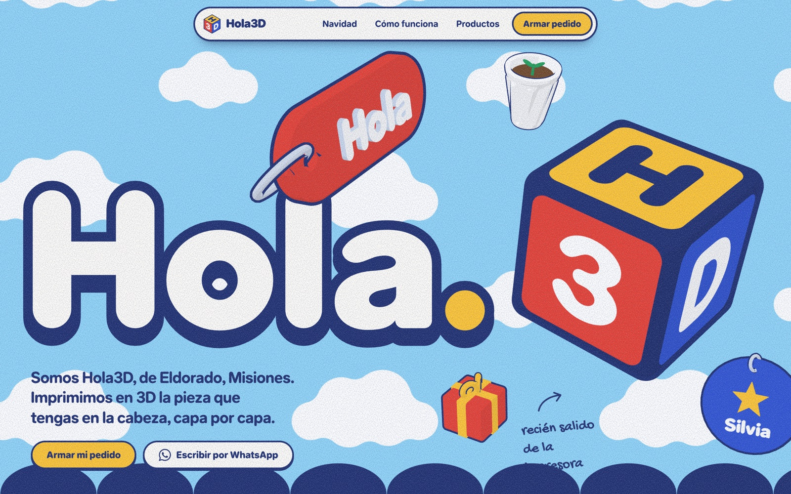
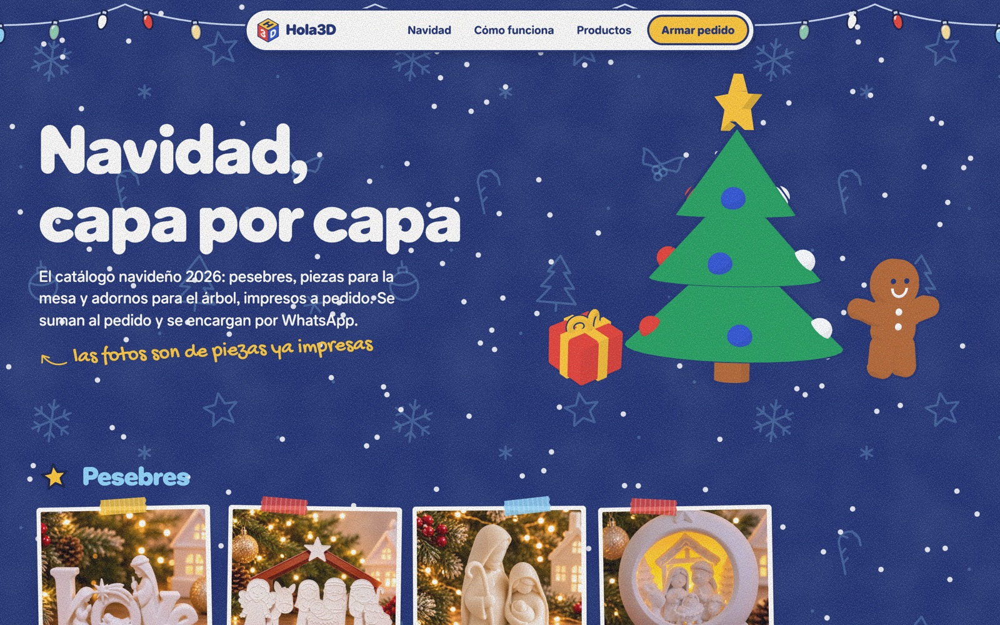
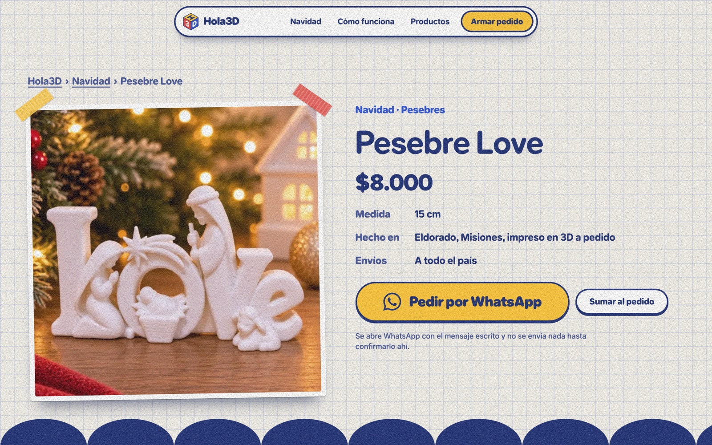
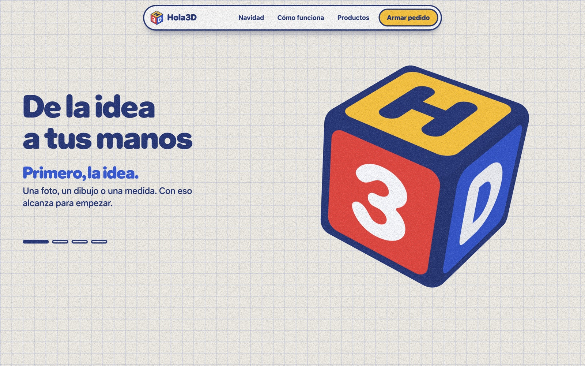
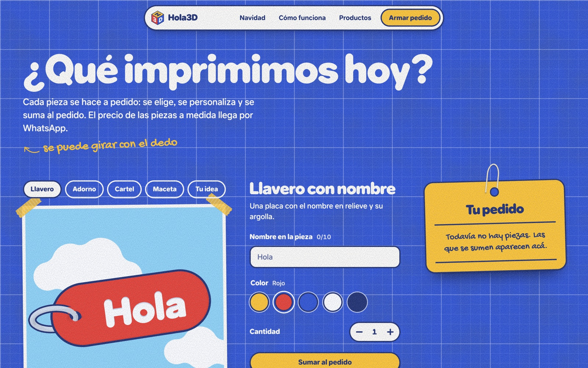
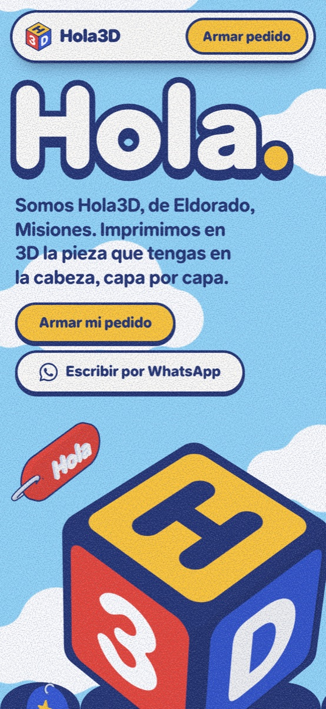
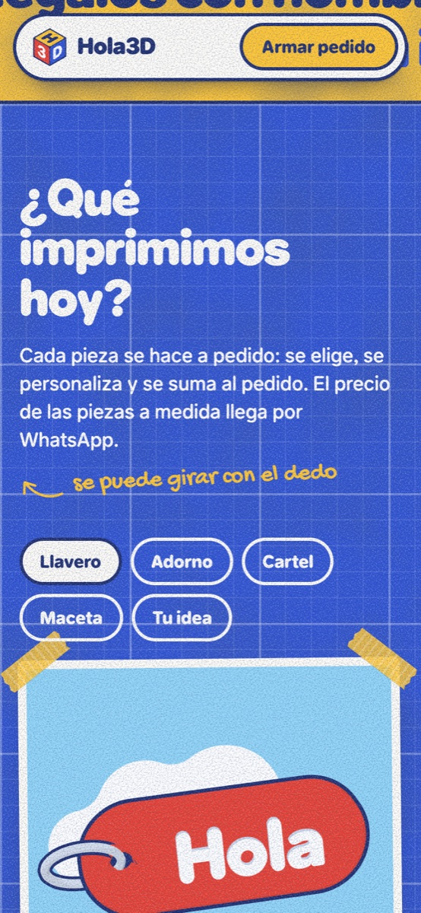

# Hola3D

**Made-to-order 3D printing from Eldorado, Misiones, Argentina. Layer by layer.**

[hola3d.com.ar](https://hola3d.com.ar)

 

This is the website of Hola3D, a small shop that prints the piece a customer has in mind: a gift with a
name on it, a keyring, a Christmas ornament, a replacement part. A visitor picks a piece, personalises it
and sends the order through WhatsApp, where the people who print it answer.

## A tour of the site

### The Christmas catalogue

Nativity scenes, pieces for the table and ornaments for the tree, each with its photo, size and price.
The photos are of pieces that have already been printed.

### A page for every piece

Each catalogue piece has its own page with the price, the size and a button that opens WhatsApp with
the message already written.

### From the idea to your hands

The process in four steps, told by the cube as the visitor scrolls: the idea, the 3D model, the print
and the delivery.

### Build the order

The visitor chooses a piece, types the name it will carry, picks a colour and watches the 3D model
change. The model can be turned with a finger. Pieces are added to an order note, and the whole order
leaves as a single WhatsApp message.

### On a phone

Most visitors arrive from Instagram on a phone, so the site is designed for that screen first.

  
  &nbsp;
  
  &nbsp;
  

## How it is built

| Part | Choice |
|------|--------|
| Pages | [Astro](https://astro.build), rendered to static HTML at build time |
| 3D pieces | [three.js](https://threejs.org), modelled in code, with no model files to download |
| Motion | [GSAP](https://gsap.com), driven by scroll |
| Orders | A WhatsApp link with the message already written; the order stays in the visitor's browser until it is sent |
| Hosting | [Cloudflare Workers](https://workers.cloudflare.com) static assets |

### Easy to find

The catalogue is written into the HTML at build time, so search engines and AI assistants read every
name, size and price without running any script.

- Structured data on every page: `LocalBusiness` for the shop, `Product` and `Offer` for each piece.
- A [`llms.txt`](src/pages/llms.txt.js) file that gives AI assistants the catalogue as plain text.
- A sitemap, canonical addresses and a social preview image.

 

Printed in Eldorado, Misiones. Shipped to the whole of Argentina.

